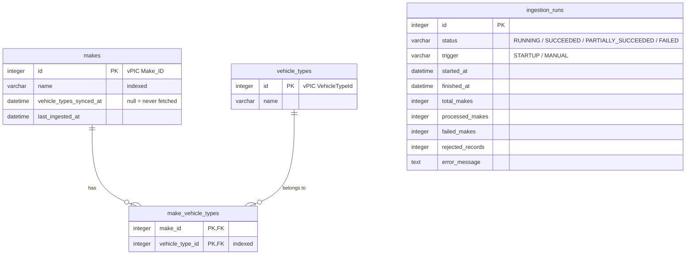

# Vehicle Catalog Service

A backend service, built with **NestJS** and **TypeScript**, that:

1. **downloads XML** from the public NHTSA vPIC API (all vehicle makes, plus the vehicle types of every make);
2. **converts it to JSON** and **combines** both sources into one unified structure;
3. **stores** the result in a database (SQLite or PostgreSQL);
4. **serves** it through a single, typed, documented **GraphQL** endpoint.

The unified shape (from the [challenge gist](https://gist.github.com/mbaigbimm/d340e7800d17737482e71c9ad1856f68)):

```json
[
  {
    "makeId": 440,
    "makeName": "ASTON MARTIN",
    "vehicleTypes": [
      { "typeId": 2, "typeName": "Passenger Car" },
      { "typeId": 7, "typeName": "Multipurpose Passenger Vehicle (MPV)" }
    ]
  }
]
```

More documentation:

- [docs/ARCHITECTURE.md](docs/ARCHITECTURE.md): how the ingestion pipeline works, plus the error handling, logging and configuration strategies (with diagrams).
- [schema.gql](schema.gql): the full GraphQL schema, generated from the code.
- [NOTES.md](NOTES.md): what was done, trade-offs, and next steps.

---

## Quick start

### Option A: Docker Compose (service + PostgreSQL)

```bash
docker compose up --build
```

Then open <http://localhost:3000/graphql> in a browser. This opens Apollo Sandbox, an in-browser tool for writing and running queries.

On first start, the service ingests all ~12,000 makes in the background, which takes about 20 minutes because vPIC needs one HTTP call per make. The API answers straight away with whatever is already stored. For a quick demo, limit the number of makes:

```bash
INGESTION_MAKE_LIMIT=500 docker compose up --build
```

Stop with `Ctrl+C`. To also delete the stored data: `docker compose down -v`.

### Option B: a single container (SQLite)

```bash
docker build -t vehicle-catalog-service .
docker run --rm -p 3000:3000 -v vehicle-data:/app/data vehicle-catalog-service
```

The database is a SQLite file inside the `vehicle-data` Docker volume, so it survives restarts.

---

## Requirements

| Tool    | Version                          | Why                                                                 |
| ------- | -------------------------------- | ------------------------------------------------------------------- |
| Docker  | 24+                              | Only needed for the Docker options above.                           |
| Node.js | **24.9 or newer** (see `.nvmrc`) | NestJS 12 ships as ES modules; Jest needs Node ≥ 24.9 to load them. |
| npm     | 11+ (bundled with Node 24)       | Package manager.                                                    |

With [nvm](https://github.com/nvm-sh/nvm): `nvm install && nvm use` reads `.nvmrc` and switches to Node 24.

---

## Running locally without Docker

```bash
nvm use                 # Node 24
npm install             # install dependencies
npm run start:dev       # start in watch mode (restarts on file changes)
```

- GraphQL: <http://localhost:3000/graphql>
- Health check: <http://localhost:3000/health>

In development (`NODE_ENV=development`, the default), `.env.development` is loaded. It enables pretty, coloured logs, stores data in `data/vehicles.dev.sqlite`, and **limits ingestion to 3 makes** so the first run finishes fast. Set `INGESTION_MAKE_LIMIT=0` in `.env.development.local` to ingest everything.

No database server is needed locally: SQLite is a single file created automatically.

To run against a local PostgreSQL instead, set `DB_TYPE=postgres` and the `DB_*` connection variables (see [Configuration](#configuration)).

---

## Build

```bash
npm run build           # compiles TypeScript from src/ into dist/
npm run start:prod      # runs dist/main.js with NODE_ENV=production
```

| Script                                            | What it does                                                |
| ------------------------------------------------- | ----------------------------------------------------------- |
| `npm run build`                                   | Compile to `dist/`.                                         |
| `npm start`                                       | Run the compiled app.                                       |
| `npm run start:dev`                               | Run from source with auto-restart.                          |
| `npm run lint`                                    | ESLint (code quality).                                      |
| `npm run format` / `format:check` /  `format:fix` | Prettier (code formatting).                                 |
| `npm run typecheck`                               | TypeScript type-check of the whole project, tests included. |
| `npm test`                                        | Unit tests.                                                 |
| `npm run test:cov`                                | Unit tests with a coverage report in `coverage/unit/`.      |
| `npm run test:e2e`                                | Integration and end-to-end tests.                           |
| `npm run test:all`                                | Both suites.                                                |
| `npm run verify`                                  | Convenience command to do all in one step before commiting. |

---

## Configuration

All configuration comes from **environment variables**. They are validated at startup with [Zod](https://zod.dev) in `src/config/env.schema.ts`. If any value is invalid, the service refuses to start and lists every problem at once.

**Where values come from**, highest priority first:

1. real environment variables (shell, Docker, CI);
2. `.env.<NODE_ENV>.local` (git-ignored, personal overrides);
3. `.env.<NODE_ENV>` (committed defaults per environment: `.env.development`, `.env.test`);
4. `.env` (git-ignored);
5. the defaults in the table below.

`.env.example` lists every variable with its default.

### General

| Variable   | Default       | Description                                                                                                                                                                  |
| ---------- | ------------- | ---------------------------------------------------------------------------------------------------------------------------------------------------------------------------- |
| `NODE_ENV` | `development` | `development`, `test` or `production`. In production, internal error messages and stack traces are hidden from API clients, and an in-memory SQLite database is not allowed. |
| `PORT`     | `3000`        | HTTP port.                                                                                                                                                                   |
| `HOST`     | `0.0.0.0`     | Network interface to listen on (`0.0.0.0` = all, required inside Docker).                                                                                                    |

### Logging

| Variable     | Default | Description                                                                                             |
| ------------ | ------- | ------------------------------------------------------------------------------------------------------- |
| `LOG_LEVEL`  | `info`  | `fatal`, `error`, `warn`, `info`, `debug`, `trace` or `silent`. `debug` also logs every vPIC request.   |
| `LOG_PRETTY` | `false` | Human-readable coloured logs instead of JSON. Development only; needs the `pino-pretty` dev dependency. |

### External vPIC API

| Variable                          | Default                                                                                | Description                                                                        |
| --------------------------------- | -------------------------------------------------------------------------------------- | ---------------------------------------------------------------------------------- |
| `VPIC_ALL_MAKES_URL`              | `https://vpic.nhtsa.dot.gov/api/vehicles/getallmakes?format=XML`                       | XML list of all makes.                                                             |
| `VPIC_VEHICLE_TYPES_URL_TEMPLATE` | `https://vpic.nhtsa.dot.gov/api/vehicles/GetVehicleTypesForMakeId/{makeId}?format=xml` | Vehicle types of one make. Must contain `{makeId}`.                                |
| `HTTP_TIMEOUT_MS`                 | `15000`                                                                                | Cancel a single request after this many milliseconds.                              |
| `HTTP_MAX_RETRIES`                | `3`                                                                                    | Retries for temporary failures (network error, timeout, HTTP 429/5xx).             |
| `HTTP_RETRY_BASE_DELAY_MS`        | `500`                                                                                  | Wait before the first retry. It doubles on each retry and has random jitter added. |

### Ingestion

| Variable                | Default | Description                                                     |
| ----------------------- | ------- | --------------------------------------------------------------- |
| `INGESTION_CONCURRENCY` | `10`    | Maximum number of simultaneous vehicle-type requests to vPIC.   |
| `INGESTION_BATCH_SIZE`  | `250`   | Makes processed and saved together in one database transaction. |
| `INGESTION_MAKE_LIMIT`  | `0`     | Only ingest the first N makes. `0` = all of them.               |

### Feature flags

| Variable                              | Default | Description                                                                    |
| ------------------------------------- | ------- | ------------------------------------------------------------------------------ |
| `FEATURE_INGESTION_ON_STARTUP`        | `true`  | Start an ingestion in the background when the service boots.                   |
| `FEATURE_INGESTION_SKIP_IF_POPULATED` | `true`  | Skip that startup ingestion if the database already contains makes.            |
| `FEATURE_INGESTION_MUTATION`          | `true`  | Allow the `startIngestion` GraphQL mutation. When off, it returns `FORBIDDEN`. |

### GraphQL

| Variable                | Default | Description                                                        |
| ----------------------- | ------- | ------------------------------------------------------------------ |
| `GRAPHQL_INTROSPECTION` | `true`  | Let clients query the schema. Tools like Apollo Sandbox need this. |
| `GRAPHQL_PLAYGROUND`    | `true`  | Serve Apollo Sandbox when opening `/graphql` in a browser.         |
| `GRAPHQL_MAX_PAGE_SIZE` | `1000`  | Largest `limit` a client may request.                              |

### Database

| Variable                      | Default                 | Description                                                       |
| ----------------------------- | ----------------------- | ----------------------------------------------------------------- |
| `DB_TYPE`                     | `sqlite`                | `sqlite` or `postgres`.                                           |
| `DB_SQLITE_PATH`              | `data/vehicles.sqlite`  | SQLite file. `:memory:` = temporary in-RAM database (tests only). |
| `DB_HOST` / `DB_PORT`         | `localhost` / `5432`    | PostgreSQL server.                                                |
| `DB_USERNAME` / `DB_PASSWORD` | `postgres` / `postgres` | PostgreSQL credentials. **Override in production.**               |
| `DB_NAME`                     | `vehicles`              | PostgreSQL database name.                                         |
| `DB_SSL`                      | `false`                 | Use TLS for the PostgreSQL connection.                            |
| `DB_LOGGING`                  | `false`                 | Log every SQL query (debugging).                                  |
| `DB_MIGRATIONS_RUN`           | `true`                  | Apply pending schema migrations on startup.                       |

---

## Data model



- **`makes`**: one row per manufacturer. The vPIC id is the primary key, so re-ingesting updates rows instead of creating duplicates.
- **`vehicle_types`**: one row per category ("Truck", "Passenger Car", ...). There are only a handful, shared by thousands of makes.
- **`make_vehicle_types`**: links a make to each of its types (a _many-to-many_ relationship). Deleting a make deletes its links (`ON DELETE CASCADE`).
- **`ingestion_runs`**: history and progress of every ingestion, so you can tell how fresh the data is and whether the last run worked.
- `vehicle_types_synced_at` tells "this make has no vehicle types" (a date is set) apart from "we could not fetch them yet" (`null`).

The schema is created by a **migration** (`src/database/migrations/`), not by automatic syncing. A test verifies the migration matches the entity classes exactly.

---

## GraphQL API

**Endpoint:** `POST /graphql` (body: `{"query": "...", "variables": {...}}`). Opening `GET /graphql` in a browser shows Apollo Sandbox, which offers autocomplete and documentation for every field.

The full schema, with a description on every type, field and argument, is in [`schema.gql`](schema.gql). It is generated from the code each time the app starts in development. 

Summary:

### Queries

| Query                                                 | Returns           | Description                                                                                                               |
| ----------------------------------------------------- | ----------------- | ------------------------------------------------------------------------------------------------------------------------- |
| `makes(filter: MakesFilter, offset: Int, limit: Int)` | `MakePage!`       | Makes ordered by name, with their vehicle types. `offset` defaults to 0, `limit` to 50 (maximum `GRAPHQL_MAX_PAGE_SIZE`). |
| `make(makeId: Int!)`                                  | `Make`            | One make, or `null`.                                                                                                      |
| `vehicleTypes`                                        | `[VehicleType!]!` | Every known vehicle type.                                                                                                 |
| `latestIngestionRun`                                  | `IngestionRun`    | The most recent ingestion run.                                                                                            |
| `ingestionRun(id: Int!)`                              | `IngestionRun`    | One run by id.                                                                                                            |

### Mutations

| Mutation                                             | Returns         | Description                                                                                            |
| ---------------------------------------------------- | --------------- | ------------------------------------------------------------------------------------------------------ |
| `startIngestion(waitForCompletion: Boolean = false)` | `IngestionRun!` | Refreshes data from vPIC. Returns immediately with a `RUNNING` run unless `waitForCompletion` is true. |

### Types

| Type                      | Fields                                                                                                                                                                      |
| ------------------------- | --------------------------------------------------------------------------------------------------------------------------------------------------------------------------- |
| `Make`                    | `makeId: Int!`, `makeName: String!`, `vehicleTypes: [VehicleType!]!`, `vehicleTypesSyncedAt: DateTime`                                                                      |
| `VehicleType`             | `typeId: Int!`, `typeName: String!`                                                                                                                                         |
| `MakePage`                | `items: [Make!]!`, `totalCount: Int!`, `offset: Int!`, `limit: Int!`, `hasNextPage: Boolean!`                                                                               |
| `MakesFilter` (input)     | `nameContains: String` (case-insensitive), `vehicleTypeId: Int`                                                                                                             |
| `IngestionRun`            | `id`, `status: IngestionStatus!`, `trigger: IngestionTrigger!`, `startedAt`, `finishedAt`, `totalMakes`, `processedMakes`, `failedMakes`, `rejectedRecords`, `errorMessage` |
| `IngestionStatus` (enum)  | `RUNNING`, `SUCCEEDED`, `PARTIALLY_SUCCEEDED`, `FAILED`                                                                                                                     |
| `IngestionTrigger` (enum) | `STARTUP`, `MANUAL`                                                                                                                                                         |

### Errors

Errors are returned in the standard GraphQL `errors` array with a machine-readable `extensions.code`:

| Code                                                 | When                                                                                   |
| ---------------------------------------------------- | -------------------------------------------------------------------------------------- |
| `BAD_USER_INPUT`                                     | Invalid argument, e.g. `limit: 0` or a negative `offset`.                              |
| `CONFLICT`                                           | `startIngestion` while a run is already in progress.                                   |
| `FORBIDDEN`                                          | `startIngestion` when `FEATURE_INGESTION_MUTATION=false`.                              |
| `GRAPHQL_VALIDATION_FAILED` / `GRAPHQL_PARSE_FAILED` | The query itself is invalid (HTTP 400).                                                |
| `INTERNAL_SERVER_ERROR`                              | Anything unexpected. In production the message is replaced by "Internal server error". |

### Performance

- Vehicle types for a whole page of makes are loaded with **one** batched query (DataLoader). This avoids one query per make, known as the "N+1 problem".
- Results are paginated and the page size is capped.
- `makes.name` and `make_vehicle_types.vehicle_type_id` are indexed for sorting and filtering.
- The schema has no cycles (`Make <-> VehicleType` ends there), so query depth is naturally bounded.

---

## Example queries

Paste these into Apollo Sandbox at <http://localhost:3000/graphql>, or use `curl`.

**The unified JSON (first page):**

```graphql
query Catalog {
  makes(limit: 20) {
    totalCount
    hasNextPage
    items {
      makeId
      makeName
      vehicleTypes {
        typeId
        typeName
      }
    }
  }
}
```

**Search by name, next page:**

```graphql
query SearchMakes {
  makes(filter: { nameContains: "honda" }, offset: 0, limit: 10) {
    totalCount
    items {
      makeId
      makeName
    }
  }
}
```

**Makes that build trucks (typeId 3):**

```graphql
query Truckmakers {
  makes(filter: { vehicleTypeId: 3 }, limit: 50) {
    totalCount
    items {
      makeName
    }
  }
}
```

**One make:**

```graphql
query AstonMartin {
  make(makeId: 440) {
    makeName
    vehicleTypesSyncedAt
    vehicleTypes {
      typeId
      typeName
    }
  }
}
```

**All vehicle types:**

```graphql
query Types {
  vehicleTypes {
    typeId
    typeName
  }
}
```

**Is the data fresh? Is an ingestion running?**

```graphql
query Freshness {
  latestIngestionRun {
    id
    status
    trigger
    startedAt
    finishedAt
    totalMakes
    processedMakes
    failedMakes
    errorMessage
  }
}
```

**Refresh the data:**

```graphql
mutation Refresh {
  startIngestion {
    id
    status
  }
}
```

With `curl`:

```bash
curl -s http://localhost:3000/graphql \
  -H 'Content-Type: application/json' \
  -d '{"query":"{ makes(limit: 3) { items { makeId makeName vehicleTypes { typeId typeName } } } }"}'
```

Health check:

```bash
curl -s http://localhost:3000/health
# {"status":"ok","database":"up","activeIngestionRunId":null}
```
