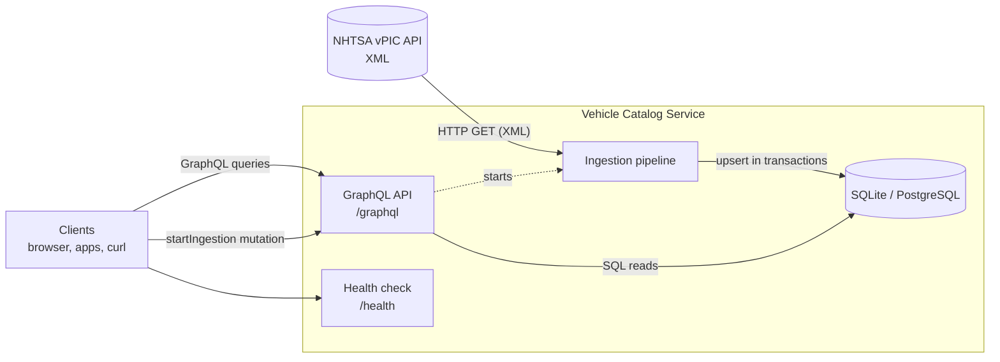
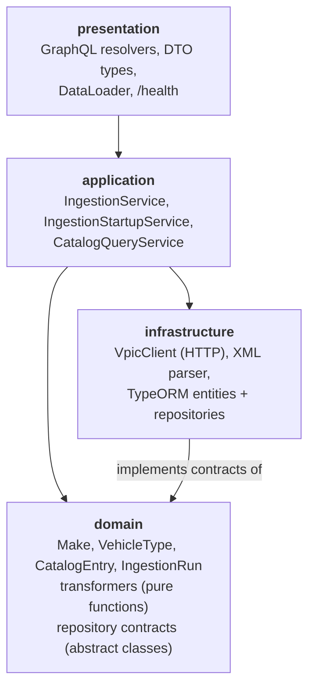
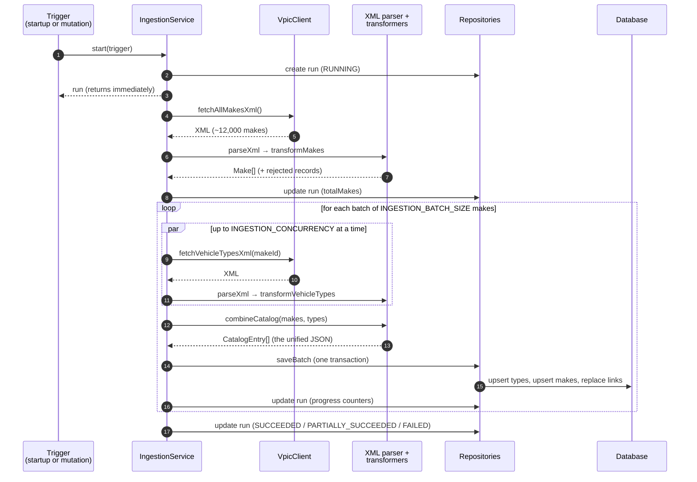
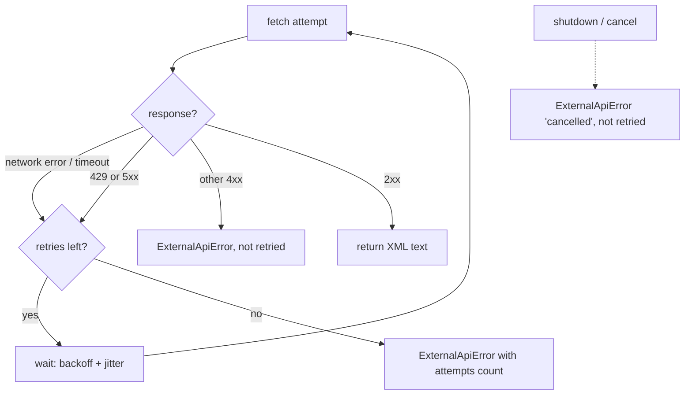

# Architecture

This document explains **how the service works inside**: the layers, the ingestion pipeline, and the strategies for error handling, logging and configuration. For setup, configuration reference and API usage, see the [README](../README.md).

## Big picture



There are two independent flows:

- **Writing (ingestion)**: download from vPIC, convert, store. It runs at startup (configurable) or on demand.
- **Reading (queries)**: GraphQL requests read only from our database and never call vPIC. Queries therefore stay fast and keep working even when vPIC is down.

---

## Layers

The code is split into four layers, following the "clean / hexagonal architecture" idea. Each layer has one kind of responsibility:



| Layer          | Folder                        | Knows about                        | Does **not** know about    |
| -------------- | ----------------------------- | ---------------------------------- | -------------------------- |
| Domain         | `src/vehicles/domain`         | Plain TypeScript, Zod              | NestJS, HTTP, SQL, GraphQL |
| Application    | `src/vehicles/application`    | Domain, the contracts, config      | GraphQL, SQL details       |
| Infrastructure | `src/vehicles/infrastructure` | `fetch`, XML, TypeORM              | GraphQL                    |
| Presentation   | `src/vehicles/presentation`   | GraphQL/HTTP, application services | SQL, vPIC                  |

The key trick is that the **domain defines repository contracts** (`VehicleCatalogRepository`, `IngestionRunRepository` as abstract classes). The **infrastructure implements them** (`TypeOrmVehicleCatalogRepository`, ...). NestJS's dependency injection then connects the two in `vehicles.module.ts`. Because of this, unit tests can swap in simple in-memory versions, and changing databases would not touch business logic.

Cross-cutting concerns live outside the feature: `src/config`, `src/logging`, `src/database`, and `src/common` (errors, retry/concurrency utilities, GraphQL options, lifecycle).

---

## Ingestion pipeline

Implemented in `src/vehicles/application/ingestion.service.ts`.



### Step by step

1. **Download all makes.** `VpicClient.fetchAllMakesXml()` downloads `getallmakes?format=XML` (about 1 MB). It uses a timeout and retries; see [network errors](#network-errors).
2. **XML → JSON.** `parseXml()` (`infrastructure/xml/xml-parser.ts`) first _validates_ the XML, then converts it with `fast-xml-parser`.
3. **JSON → domain objects.** `transformMakes()` (`domain/transformers/makes.transformer.ts`) checks the response envelope with Zod, then converts each record.
4. **Optional limit.** With `INGESTION_MAKE_LIMIT=N`, only the first N makes are processed.
5. **Batches.** Makes are split into batches of `INGESTION_BATCH_SIZE` (default 250). For each batch:
   1. Vehicle types are downloaded for every make, with **at most `INGESTION_CONCURRENCY` requests in flight** (`mapWithConcurrency` in `common/utils/concurrency.ts`). This is fast without overloading vPIC. Each response goes through `parseXml` and `transformVehicleTypes`.
   2. `combineCatalog()` (`domain/transformers/catalog.combiner.ts`) merges makes and their types into the target shape: `{ makeId, makeName, vehicleTypes: [{ typeId, typeName }] }`.
   3. `saveBatch()` stores the batch in **one database transaction**: upsert vehicle types, upsert makes, then replace each make's links. If anything fails, the whole batch is rolled back.
   4. Progress counters on the `ingestion_runs` row are updated, so clients can watch progress with `ingestionRun(id)`.
6. **Final status:**
   - `SUCCEEDED`: everything worked.
   - `PARTIALLY_SUCCEEDED`: some makes' vehicle types could not be fetched; those makes keep their previously stored types.
   - `FAILED`: a fatal error, or every make failed.

---

## Error handling strategy

### Principles

1. **Classify errors.** Every expected failure becomes one of a few error classes (`src/common/errors/app-errors.ts`), each with a stable `code` and structured `details`:

   | Class                          | Code                        | Raised when                                                     | Retryable?                                             |
   | ------------------------------ | --------------------------- | --------------------------------------------------------------- | ------------------------------------------------------ |
   | `ExternalApiError`             | `EXTERNAL_API_ERROR`        | Network failure, timeout, non-2xx response from vPIC            | 429/5xx/timeout/network: yes; 4xx and cancellation: no |
   | `XmlParseError`                | `XML_PARSE_ERROR`           | Empty or invalid XML                                            | No                                                     |
   | `TransformationError`          | `TRANSFORMATION_ERROR`      | The response _envelope_ has the wrong shape (e.g. no `Results`) | No                                                     |
   | `PersistenceError`             | `PERSISTENCE_ERROR`         | Any database failure (wrapped by `withPersistenceErrors`)       | No                                                     |
   | `IngestionAlreadyRunningError` | `INGESTION_ALREADY_RUNNING` | Second run requested                                            | No                                                     |
   | `InvalidInputError`            | `INVALID_INPUT`             | Bad GraphQL arguments                                           | No                                                     |

   Anything that is _not_ an `AppError` is treated as a bug and logged with its full stack trace.

2. **Contain failures at the smallest sensible scope:**
   - one malformed **record**: skip it, count it, continue;
   - one **make's** vehicle types fail: keep that make's old types, count it, continue;
   - the **makes list** or a **database write** fails: stop the run, mark it `FAILED`, keep existing data;
   - a **GraphQL request** fails: only that request gets an error.

3. **Always leave a record.** The pipeline never throws to its caller; every outcome is written to `ingestion_runs.status` and `error_message` (e.g. `EXTERNAL_API_ERROR: vPIC responded with HTTP 503`).

### Network errors

`VpicClient` (`infrastructure/vpic/vpic.client.ts`) wraps `fetch` with:

- a **timeout** per attempt (`HTTP_TIMEOUT_MS`), combined with the caller's cancellation signal;
- **retries** with exponential backoff and jitter (`common/utils/retry.ts`). The delay is `HTTP_RETRY_BASE_DELAY_MS × 2^(attempt−1)`, plus up to 50% random extra, capped at 30 s. Only temporary errors are retried; a 404 or a cancellation is not;
- clear messages that tell a timeout apart from a cancellation or a refused connection.



### Errors returned to API clients

`src/common/graphql/format-graphql-error.ts` gives every GraphQL error a stable `extensions.code`: `BAD_USER_INPUT`, `CONFLICT`, `FORBIDDEN`, `GRAPHQL_VALIDATION_FAILED`, or `INTERNAL_SERVER_ERROR`. In **production**, internal error messages become "Internal server error" and stack traces are removed, so database details never leak to clients. The full error is still logged.

### Last-resort handlers

`src/common/lifecycle/process-error-handlers.ts` handles the two kinds of error nobody caught:

- an `unhandledRejection` (a failed Promise nobody handled) is logged as `error`;
- an `uncaughtException` is logged as `fatal`, then the process exits with code 1. The container orchestrator then restarts a clean process instead of leaving one in an unknown state.

---

## Logging strategy

- **Library:** [Pino](https://getpino.io) via `nestjs-pino`. It writes one **JSON object per line** to stdout, which is the standard for containers: Docker, Kubernetes and log platforms collect stdout and can index every field.
- **Every log line has:** `level` (as text, e.g. `"error"`), `time` (ISO 8601), `service`, `env`, `context` (the class that logged), `msg`, and event-specific fields such as `runId`, `makeId`, `url`, `status` or `attempts`.
- **HTTP requests** are logged automatically with a **request id**. It reuses an incoming `x-request-id` header or generates a UUID, and is returned in the response header, so one request can be traced through all its log lines. Status codes ≥ 500 are logged as `error` and 4xx as `warn`. `/health` is not logged, to avoid noise. `Authorization` and `Cookie` headers are redacted.
- **Development:** `LOG_PRETTY=true` switches to coloured, human-readable lines (pino-pretty).

What gets logged:

| Event                                     | Level   | Example `msg`                                                                                                         |
| ----------------------------------------- | ------- | --------------------------------------------------------------------------------------------------------------------- |
| Startup                                   | `info`  | `Application started` (with port, environment, URLs)                                                                  |
| Shutdown                                  | `info`  | `Application shutting down`, `Application shut down`                                                                  |
| vPIC request retried                      | `warn`  | `vPIC request failed, retrying` (url, attempt, delayMs, err)                                                          |
| vPIC request succeeded                    | `debug` | `vPIC request succeeded` (url, durationMs, bytes)                                                                     |
| One make's types failed after all retries | `warn`  | `Could not load vehicle types for make; keeping previously stored types` (makeId, error code/message/status/attempts) |
| Makes list failed after all retries       | `error` | `Ingestion failed` (error code/message/url/status/attempts)                                                           |
| Malformed records skipped                 | `warn`  | `Transformation skipped malformed records` (source, count, sample)                                                    |
| Ingestion progress                        | `info`  | `Ingestion started`, `Makes downloaded and transformed`, `Ingestion batch saved`, `Ingestion finished`                |
| Unexpected ingestion error (a bug)        | `error` | `Ingestion failed unexpectedly` (+ stack trace)                                                                       |
| GraphQL client error                      | `warn`  | `GraphQL request rejected` (code, path)                                                                               |
| GraphQL server error                      | `error` | `GraphQL request failed` (+ stack trace)                                                                              |
| Unhandled promise rejection               | `error` | `Unhandled promise rejection` (+ stack trace)                                                                         |
| Uncaught exception                        | `fatal` | `Uncaught exception; exiting`, then exit code 1                                                                       |
| Startup failure                           | `fatal` | `Application failed to start` (e.g. invalid configuration), then exit code 1                                          |

Example line (shortened):

```json
{
  "level": "warn",
  "time": "2026-10-19T10:21:07.412Z",
  "service": "vehicle-catalog-service",
  "env": "production",
  "context": "VpicClient",
  "url": "https://vpic.nhtsa.dot.gov/api/vehicles/GetVehicleTypesForMakeId/474?format=xml",
  "attempt": 1,
  "delayMs": 612,
  "err": {
    "type": "ExternalApiError",
    "message": "vPIC responded with HTTP 503",
    "code": "EXTERNAL_API_ERROR",
    "stack": "..."
  },
  "msg": "vPIC request failed, retrying"
}
```

---

## Configuration approach

- **One schema, one source of truth:** `src/config/env.schema.ts` lists every variable with its type, allowed range, default and a comment. Strings from the environment are converted into numbers, booleans and URLs there.
- **Fail fast:** validation runs before anything else starts. A typo like `PORT=abc` stops the service with a clear message, instead of causing a strange failure later.
- **Cross-field rules:** e.g. `VPIC_VEHICLE_TYPES_URL_TEMPLATE` must contain `{makeId}`, and production may not use an in-memory database.
- **Typed access:** the rest of the code never reads `process.env`. It injects `AppConfigService`, which exposes grouped, typed settings (`config.ingestion.concurrency`, `config.database`, ...).
- **Environments:** `development` (pretty logs, small ingestion, local SQLite file), `test` (`.env.test`: silent logs, in-memory DB, no startup ingestion, no retry delays), and `production` (JSON logs, masked errors; real values come from environment variables, e.g. in `docker-compose.yml`).
- **Feature flags** (`FEATURE_*`) are ordinary validated variables. They switch behaviour (startup ingestion, the mutation) without code changes.
- Tests pass overrides straight to `AppModule.forRoot({...})`, which go through the same validation.

---

## Startup and shutdown

**Startup** (`src/main.ts`):

1. Build the Nest app. Logs are buffered until the logger is ready.
2. Load and validate configuration. If it is invalid: fatal log, exit 1.
3. Connect to the database (with retries outside tests) and run pending migrations.
4. Build the GraphQL schema from the TypeScript classes.
5. `IngestionStartupService`:
   - marks runs left `RUNNING` by a crashed process as `FAILED`;
   - unless disabled or the DB is already populated, starts an ingestion **in the background**, so the API is usable immediately.
6. Listen on `HOST:PORT` and log `Application started`.

**Shutdown** (`SIGTERM` from `docker stop`, or `Ctrl+C`):

1. `Application shutting down` is logged.
2. `IngestionService.beforeApplicationShutdown` cancels in-flight vPIC requests and waits for the run to be recorded as `FAILED` ("the application is shutting down").
3. The HTTP server and the database connection close.
4. `Application shut down` is logged and the process exits with code 0. A second signal during shutdown forces an exit with code 1.

This is handled in `src/common/lifecycle/shutdown-signals.ts` rather than with NestJS's `enableShutdownHooks()`. The built-in version kills the process right after the hooks run, before Pino has flushed the final log lines.
